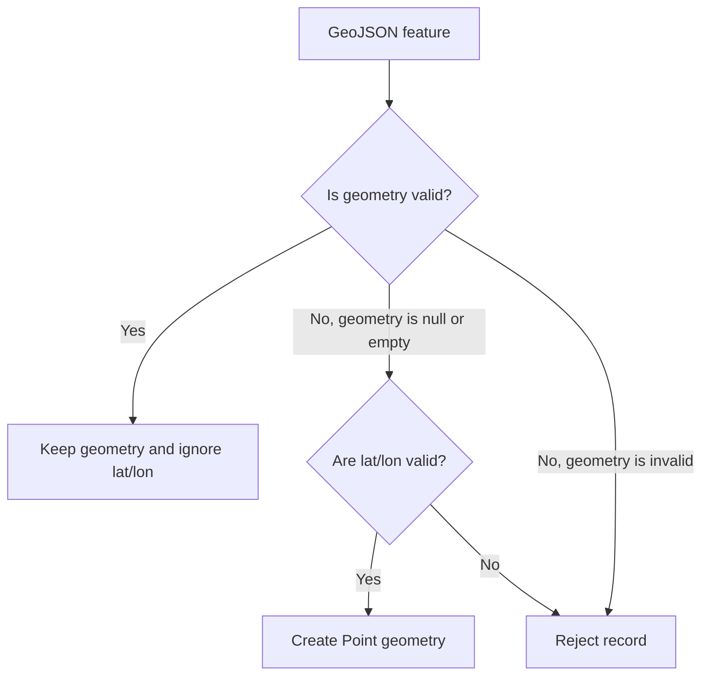

# KfW Project Location Model

This repository contains all necessary information to collect georeferenced project locations according to the Project Location Model for International Development Cooperation used by the KfW Development Bank and its partners and stakeholders. 

You can find the documentation in a user-friendly format [here](https://mapme-initiative.github.io/project_location_model/). 

The documentation specifies everything you need to know to collect project location data. It also contains a validator tool that can be used before submissions. You can find the validator tool [here](https://mapme-initiative.github.io/project_location_model/project-location-validator/index.html). 

In case you need support or in case you would like to propose improvements to the model, the validator tool or the repository, feel free to create an issue or fork the repository and create an upstream pull request.

## Project Location Validator

The [Location Validator](https://mapme-initiative.github.io/project_location_model/project-location-validator/index.html) checks project location data against the Project Location Model and shows locations on a map.

**Supported formats:** Excel (`.xlsx`), CSV, and GeoJSON.

### Map pin legend

Pins use the same teardrop shape; color and center mark show the geometry type:

| Type | Pin |
|------|-----|
| Point |  blue, white dot |
| Line |  orange, white bar |
| Polygon |  green, white triangle |

### GeoJSON validation rules

For GeoJSON uploads, existing feature geometry takes priority over `latitude` / `longitude` in properties:

- If geometry is valid → keep it and ignore lat/lon
- If geometry is null or empty → use lat/lon when they are valid (creates a Point)
- If geometry is null or empty and lat/lon are not valid → reject the record
- If geometry is present but invalid → reject the record (no fallback to lat/lon)

Excel and CSV uploads still build Point geometries from latitude/longitude as before.



# Validator tool (for developers)

## GUI

### Install
```bash
cd frontend && npm install
npm run dev
```

### E-Mail-Button:
one of the column will be used in the email-button. This can be changed with config-file at [AppConfig.jsonc](frontend/src/AppConfig.jsonc)  

## Analyze-Tools
* SonarQube: for code quality
* CodeQL: for code security
* Dependabot: for dependency updates (maybe renovate-bot)
* Test-Coverage: through jest and is visible in pull-requests

## Structure
* frontend: the React frontend
* model: json-schema-files

## How example-excel-files work
* the files are automatically copied from assets
* to make them visible for the end-user - you've to add a link in the [FileValidator.tsx](frontend/src/components/FileValidator.tsx) file


### This project is built with [Vite](https://vitejs.dev/) and React using TypeScript. Below are instructions to run and manage the project locally.

---

### Prerequisites

* **Node.js** (version 14 or higher)
* **npm** (version 6 or higher) or **yarn**

Ensure you have Node.js and npm installed:

```bash
node -v
npm -v
```

---

### Getting Started

1. **Clone the repository**

```bash
git clone https://github.com/mapme-initiative/project_location_model/;
cd project_location_model;
```


2. **Install dependencies**

```bash
npm install
# or using yarn
yarn install
````

---

### Running Locally

To start the development server and begin working on the project:

```bash
npm run dev
```

This will:

* Launch Vite in development mode.
* Enable hot module replacement (HMR).
* Serve the app on `http://localhost:5173/` by default.

You should see output similar to:

```
  vite vX.X.X dev server running at:
  > Local:    http://localhost:5173/
  > Network:  use --host to expose
```

Open your browser and navigate to `http://localhost:5173/` to view the app.

---

### Linting

To ensure code quality and consistency, run:

```bash
npm run lint
```

This will use ESLint to analyze all `.ts` and `.tsx` files and enforce rules, reporting any unused disable directives and failing if there are any warnings or errors.

---

### Configuration

* **Vite config:** `vite.config.ts` contains project-specific Vite configurations (e.g., path aliases, plugins).
* **TypeScript config:** `tsconfig.json` sets up TypeScript compilation options.
* **ESLint config:** `.eslintrc.*` contains linting rules and settings.

---

### Troubleshooting

* If you encounter port conflicts, you can specify a different port:

  ```bash
  vite --port 3000 --mode development
  ```

* Clear Vite cache:

  ```bash
  rm -rf node_modules/.vite
  ```

* For detailed error stacks, enable debug logging:

  ```bash
  DEBUG=vite:* npm run dev
  ```

---

### Contributing

Feel free to open issues or submit pull requests. Please follow the existing coding conventions and ensure all lint checks pass.

---


